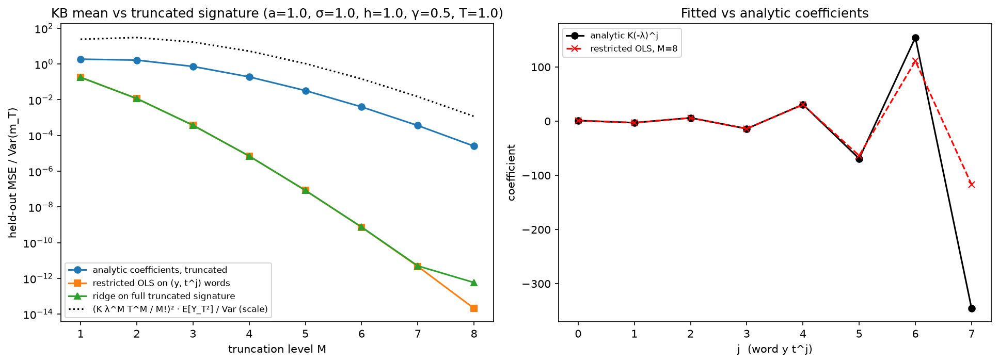
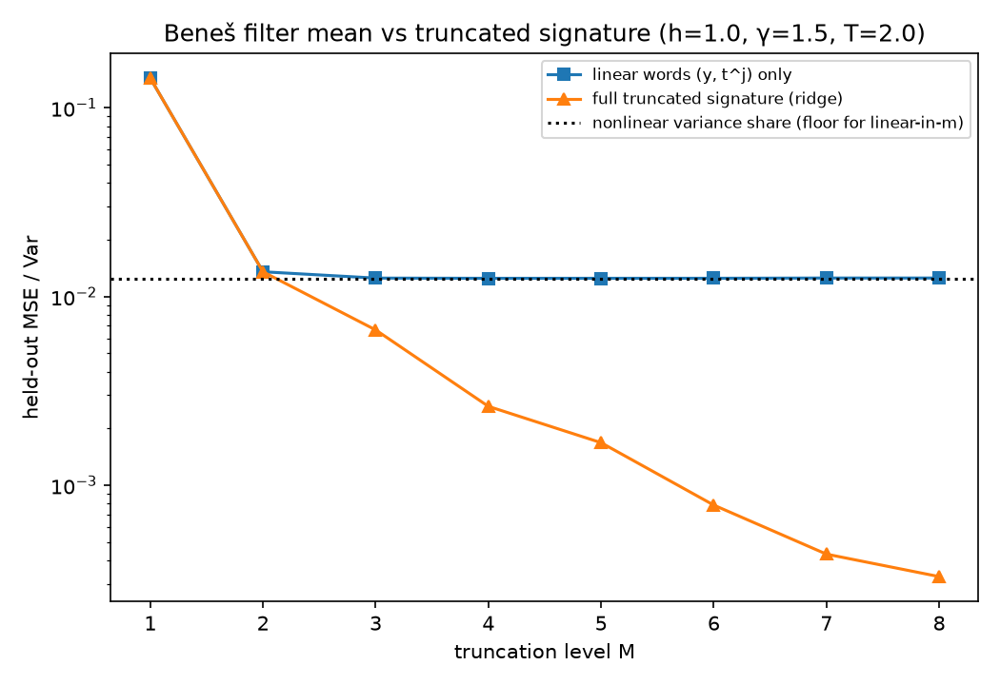

# Filters as signature functionals: truncation error

The Kalman–Bucy filter mean is a linear functional of the signature of the time-augmented observation path (t, Y_t). This is Theorem 1 of Cohen, Mantoan, Nesheim, de Paula, Turrell & Yang (2023), [*Nowcasting using regression on signatures*](https://arxiv.org/abs/2305.10256). How fast the *truncated* signature representation converges is left open there (their Appendix H.3). This repository studies that truncation error numerically, for a linear-Gaussian filter and for a nonlinear filter with a closed-form answer, and contains a note deriving bounds.

## Results

**Linear-Gaussian (scalar Ornstein–Uhlenbeck signal, constant-gain Kalman–Bucy filter).** Code: `d2_kb_signature.py`, outputs in `results/d2/`.

Setup: 6,000 simulated paths. The filter mean was checked against a discrete Kalman filter (RMSE 1.7e-4), and `esig` against `pysiglib` (agreement to 2e-16).

| Coefficients | Held-out MSE / Var, M = 1 → 8 | Decay per signature level |
|---|---|---|
| exact series coefficients, truncated | 1.87 → 2.5e-5 | ≈ (λT/(M+1))² (Taylor remainder) |
| least-squares re-fit on the words (y, tʲ) | 1.8e-1 → 2.1e-14 | ≈ **(λT/4M)²** (best polynomial approximation of the kernel) |

The re-fit rate matches (λT/4M)² closely for M = 2, …, 8.



**Nonlinear (Beneš filter, exact posterior mean m_T + P_T tanh m_T).** Code: `d2_benes_prepare.py`, `d2_benes_fit.py`, outputs in `results/d2_benes/`.

Setup: the closed form was checked against a 20,000-particle filter (RMSE 0.014, target sd 1.91).

- **Linear words only:** the fit stops exactly at the share of variance that is nonlinear in m_T (1.25 × 10⁻²).
- **Full signature:** goes below that floor, but only by about a factor of 2 per level (7.8 × 10⁻⁴ at M = 6). M ≥ 7 is limited by the number of training paths.



## Note

A write-up with proofs of truncation bounds for the Ornstein–Uhlenbeck case is in preparation.

## Reproduce

```bash
python -m venv .venv && .venv/Scripts/python -m pip install -r requirements.txt
.venv/Scripts/python d2_kb_signature.py          # ~3 min
.venv/Scripts/python d2_benes_prepare.py         # ~5 min (simulation, validation, signature cache)
.venv/Scripts/python d2_benes_fit.py             # seconds
```

Signatures are computed with `esig` (`iisignature` had no Python 3.13 Windows wheel), on piecewise-linear interpolations of paths sampled at dt = 1e-3.

## Licence

MIT (see `LICENSE`).

## Use of AI tools

Parts of this repository (experiment code, scripts, documentation) were written with the help of an AI coding assistant (Claude, Anthropic), working to my specification and decisions; commits co-authored by the assistant are marked "Co-Authored-By: Claude". I chose the experiments, checked the results and am responsible for the conclusions.
